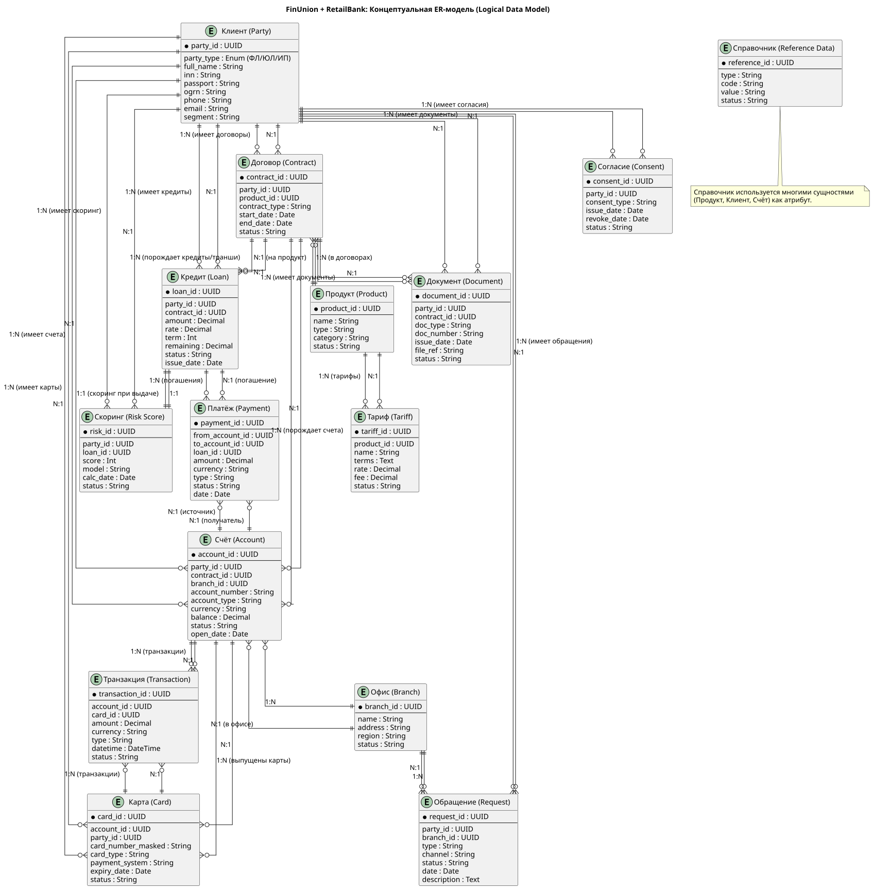

# logical-data-model.md — логическая модель данных (ERD): FinUnion + RetailBank

> Назначение документа: построить концептуальную ER-модель ключевых сущностей для объединенной компании. Модель показывает и какие сущности существуют, и как они связаны между собой (с учетом кардинальности)

## Сводная таблица связей

| От | К | Кардинальность | Смысл |
| -- | -- | -- | -- |
| Клиент (Party) | Договор (Contract) | 1:N | Один клиент может иметь несколько договоров (счет, кредит, карта) |
| Клиент (Party) | Счет (Account) | 1:N | Один клиент может иметь несколько счетов |
| Клиент (Party) | Карта (Card) | 1:N | Один клиент может иметь несколько карт |
| Клиент (Party) | Кредит (Loan) | 1:N | Один клиент может иметь несколько кредитов |
| Клиент (Party) | Обращение (Request) | 1:N | Один клиент может иметь несколько обращений |
| Клиент (Party) | Согласие (Consent) | 1:N | Один клиент может иметь несколько согласий (разные цели согласия) |
| Клиент (Party) | Документ (Document) | 1:N | Один клиент может иметь несколько документов (паспорт, сканы) |
| Клиент (Party) | Скоринг (Risk Score) | 1:N | Один клиент может иметь несколько оценок скоринга (для истории) |
| Договор (Contract) | Клиент (Party) | N:1 | Договор принадлежит одному клиенту |
| Договор (Contract) | Продукт (Product) | N:1 | Договор заключается на один продукт |
| Договор (Contract) | Счет (Account) | 1:N | Один договор может порождать несколько счетов |
| Договор (Contract) | Кредит (Loan) | 1:N | Один договор может порождать несколько кредитов (чаще наверное 1:1, но вероятно зависит от договора, по крайней мере 1:N это покрывает) |
| Договор (Contract) | Документ (Document) | 1:N | Один договор может иметь несколько документов (скан, приложение) |
| Счет (Account) | Клиент (Party) | N:1 | Несколкьо счетов может принадлежать одному клиенту |
| Счет (Account) | Договор (Contract) | N:1 | Несколько счетов может быть открывыто по договору |
| Счет (Account) | Карта (Card) | 1:N | К счету может быть выпущено несколько карт |
| Счет (Account) | Транзакция (Transaction) | 1:N | По счету проходит много транзакций |
| Счет (Account) | Офис (Branch) | N:1 | Счет привязан к офису открытия |
| Карта (Card) | Счет (Account) | N:1 | Можно привязать несколько карт на один счет |
| Карта (Card) | Клиент (Party) | N:1 | Несколько карт могут быть выпущены на одного клиента |
| Карта (Card) | Транзакция (Transaction) | 1:N | По карте проходит много транзакций |
| Кредит (Loan) | Клиент (Party) | N:1 | Множество кредитов может быть открыто на одного клиента |
| Кредит (Loan) | Договор (Contract) | N:1 | Кредит выдается по договору (в общем случае вероятно 1:1, но наверное зависит от договора) |
| Кредит (Loan) | Платеж (Payment) | 1:N | По кредиту проходит много платежей (погашение) |
| Кредит (Loan) | Скоринг (Risk Score) | 1:1 | При выдаче кредита используется один скоринг |
| Транзакция (Transaction) | Счет (Account) | N:1 | Множество транзакций будет проходить по одному счету |
| Транзакция (Transaction) | Карта (Card) | N:1 | Множество транзакций по карте |
| Платеж (Payment) | Счет (Account) (источник) | N:1 | Каждый из множества платежей списывается со счета |
| Платеж (Payment) | Счет (Account) (получатель) | N:1 | Каждый из множества платеж зачисляется на счет |
| Платеж (Payment) | Кредит (Loan) | N:1 | Множество платежей может проходить в рамках одного кредита |
| Продукт (Product) | Договор (Contract) | 1:N | Один продукт используется во многих договорах |
| Продукт (Product) | Тариф (Tariff) | 1:N | Один продукт может иметь несколько тарифов |
| Обращение (Request) | Клиент (Party) | N:1 | Множество обращений принадлежит одному клиенту |
| Обращение (Request) | Офис (Branch) | N:1 | Множество обращений может быть привязано к офису |
| Согласие (Consent) | Клиент (Party) | N:1 | Множество согласий принадлежит клиенту |
| Скоринг (Risk Score) | Клиент (Party) | N:1 | Скоринг рассчитывается для клиента и таких расчетов может быть несколько для истории |
| Скоринг (Risk Score) | Кредит (Loan) | 1:1 | Скоринг используется при выдаче кредита |
| Документ (Document) | Клиент (Party) | N:1 | Множество документов принадлежит клиенту |
| Документ (Document) | Договор (Contract) | N:1 | Множество документов может быть связаны с договором (сканы) |
| Офис (Branch) | Счет (Account) | 1:N | В офисе открывается много счетов |
| Офис (Branch) | Обращение (Request) | 1:N | В офисе обрабатывается много обращений |
| Тариф (Tariff) | Продукт (Product) | N:1 | Тариф продукта, тарифы могут меняться по отношению к продукту |

## Концептуальная диаграмма ER-модели

**ПРИМЕЧАНИЕ:** Справочник (Reference Data) используется многими сущностями (Продукт, Клиент, Счет и т.д.). На ERD показывается как отдельная справочная сущность без прямых связей.

