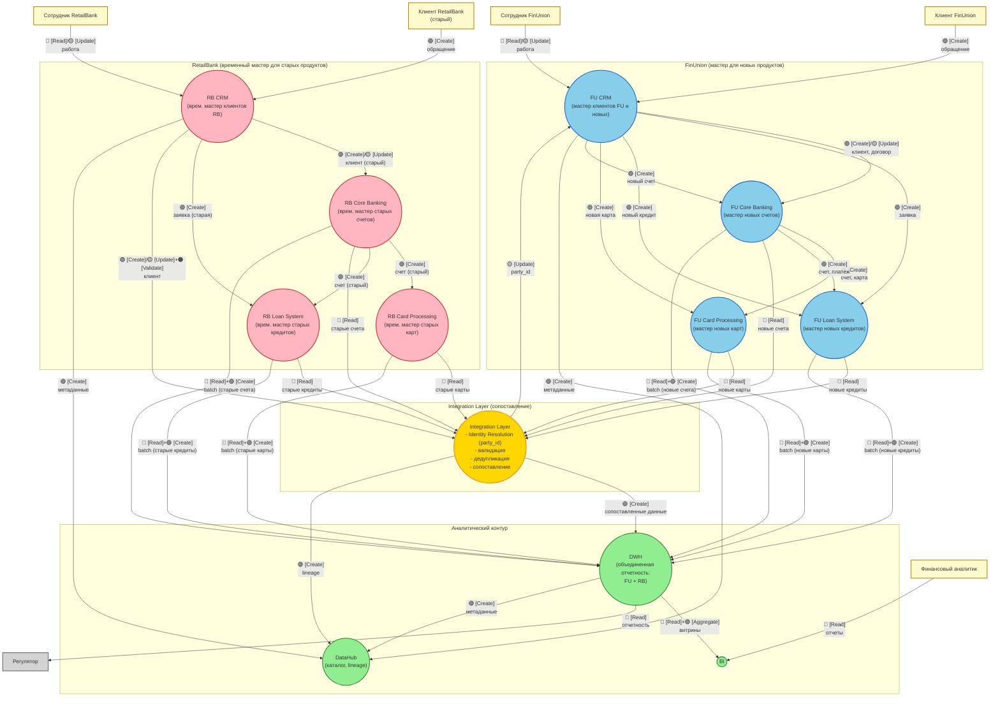

# data-flows.md — потоки данных (DFD): FinUnion + RetailBank

> Назначение документа: построить DFD уровня 0 для промежуточного состояния через 3 месяца после слияния FinUnion и RetailBank. Диаграмма позволяет проследить перемещения и трансформации данных, с указанием на каких этапах какие действия происходят:
>
> - 🟢 **C** — Create (создание)
> - 🔵 **R** — Read (чтение)
> - 🟡 **U** — Update (обновление)
> - 🔴 **D** — Delete (удаление)
> - ⚪ **E** — Enrich (обогащение)
> - 🟠 **V** — Validate (валидация)
> - 🟣 **A** — Aggregate (агрегация)

## DFD level 0 (промежуточное состояние, 3 месяца)

## Описание ключевых потоков

### 1. Потоки от клиентов (FinUnion)

| ## | Источник | Приемник | Сущность | Действие | Режим обмена | Обоснование |
| -- | -- | -- | -- | -- | -- | -- |
| 1 | Клиент FU | FU CRM | Клиент, Обращение | 🟢 [Create] | Sync | Новый клиент или старый клиент FU |
| 2 | Сотрудник FU | FU CRM | Клиент | 🔵 [Read]/🟡 [Update] | Sync | Работа с клиентом |

### 2. Потоки внутри FinUnion

| ## | Источник | Приемник | Сущность | Действие | Режим обмена | Обоснование |
| -- | -- | -- | -- | -- | -- | -- |
| 3 | FU CRM | FU Core | Клиент, Договор | 🟢 [Create]/🟡 [Update] | Sync | Создание договора |
| 4 | FU CRM | FU Loans | Заявка на кредит | 🟢 [Create] | Sync | Заявка на кредит |
| 5 | FU Core | FU Cards | Счет, Карта | 🟢 [Create] | Sync | Выпуск карты |
| 6 | FU Core | FU Loans | Счет, Платеж | 🟢 [Create] | Sync | Погашение кредита |

### 3. Потоки от клиентов (RetailBank, старые)

| ## | Источник | Приемник | Сущность | Действие | Режим обмена | Обоснование |
| -- | -- | -- | -- | -- | -- | -- |
| 7 | Клиент RB | RB CRM | Клиент, Обращение | 🟢 [Create] | Sync | Старый клиент RB |
| 8 | Сотрудник RB | RB CRM | Клиент | 🔵 [Read]/🟡 [Update] | Sync | Работа с клиентом |

### 4. Потоки внутри RetailBank (старые продукты)

| ## | Источник | Приемник | Сущность | Действие | Режим обмена | Обоснование |
| -- | -- | -- | -- | -- | -- | -- |
| 9 | RB CRM | RB Core | Клиент (старый) | 🟢 [Create]/🟡 [Update] | Sync | Старый договор |
| 10 | RB CRM | RB Loans | Заявка (старая) | 🟢 [Create] | Sync | Старый кредит |
| 11 | RB Core | RB Cards | Счет (старый) | 🟢 [Create] | Sync | Старая карта |
| 12 | RB Core | RB Loans | Счет (старый) | 🟢 [Create] | Sync | Старый платеж |

### 5. Потоки, когда старый клиент RetailBank хочет новые продукты

| ## | Источник | Приемник | Сущность | Действие | Режим обмена | Обоснование |
| -- | -- | -- | -- | -- | -- | -- |
| 13 | RB CRM | Integration Layer | Клиент | 🟢 [Create]/🟡 [Update] + 🟠 [Validate] | Async | Сопоставление клиента |
| 14 | Integration Layer | FU CRM | Клиент (party_id) | 🟡 [Update] | Async | Присвоение party_id |
| 15 | FU CRM | FU Loans | Новый Кредит | 🟢 [Create] | Sync | Новый кредит для старого клиента RB |
| 16 | FU CRM | FU Cards | Новая Карта | 🟢 [Create] | Sync | Новая карта для старого клиента RB |
| 17 | FU CRM | FU Core | Новый Счет | 🟢 [Create] | Sync | Новый счет для старого клиента RB |

### 6. Сопоставление продуктов (Integration Layer)

| ## | Источник | Приемник | Сущность | Действие | Режим обмена | Обоснование |
| -- | -- | -- | -- | -- | -- | -- |
| 18 | FU Loans | Integration Layer | Новые Кредиты | 🔵 [Read] | Async | Сопоставление |
| 19 | RB Loans | Integration Layer | Старые Кредиты | 🔵 [Read] | Async | Сопоставление |
| 20 | FU Cards | Integration Layer | Новые Карты | 🔵 [Read] | Async | Сопоставление |
| 21 | RB Cards | Integration Layer | Старые Карты | 🔵 [Read] | Async | Сопоставление |
| 22 | FU Core | Integration Layer | Новые Счета | 🔵 [Read] | Async | Сопоставление |
| 23 | RB Core | Integration Layer | Старые Счета | 🔵 [Read] | Async | Сопоставление |

### 7. Потоки в DWH (batch)

| ## | Источник | Приемник | Сущность | Действие | Режим обмена | Обоснование |
| -- | -- | -- | -- | -- | -- | -- |
| 24 | FU Core | DWH | Новые Счета | 🔵 [Read]+🟢 [Create] | Batch | Отчетность |
| 25 | FU Cards | DWH | Новые Карты | 🔵 [Read]+🟢 [Create] | Batch | Отчетность |
| 26 | FU Loans | DWH | Новые Кредиты | 🔵 [Read]+🟢 [Create] | Batch | Отчетность |
| 27 | RB Core | DWH | Старые Счета | 🔵 [Read]+🟢 [Create] | Batch | Отчетность |
| 28 | RB Cards | DWH | Старые Карты | 🔵 [Read]+🟢 [Create] | Batch | Отчетность |
| 29 | RB Loans | DWH | Старые Кредиты | 🔵 [Read]+🟢 [Create] | Batch | Отчетность |
| 30 | Integration Layer | DWH | Сопоставленные данные | 🟢 [Create] | Batch | Единая картина |

### 8. Потоки к потребителям

| ## | Источник | Приемник | Сущность | Действие | Режим обмена | Обоснование |
| -- | -- | -- | -- | -- | -- | -- |
| 31 | DWH | BI | Витрины | 🔵 [Read]+🟣 [Aggregate] | Sync | Отчеты |
| 32 | DWH | Регулятор | Отчетность | 🔵 [Read] | Batch | Регулятор |

### 9. Потоки в DataHub (каталог)

| ## | Источник | Приемник | Сущность | Действие | Режим обмена | Обоснование |
| -- | -- | -- | -- | -- | -- | -- |
| 33 | FU CRM | DataHub | Метаданные | 🟢 [Create] | Async | Каталог |
| 34 | RB CRM | DataHub | Метаданные | 🟢 [Create] | Async | Каталог |
| 35 | Integration Layer | DataHub | Lineage | 🟢 [Create] | Async | Каталог |
| 36 | DWH | DataHub | Метаданные | 🟢 [Create] | Async | Каталог |
