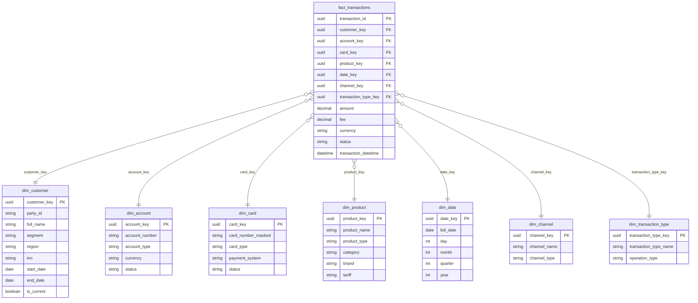

# analytical-model.md — аналитическая модель данных: FinUnion + RetailBank

> Назначение документа: спроектировать аналитическую модель (по схеме "звезда" или "снежинка") для одной аналитической области (выбрана область Транзакции). Модель должна поддерживать задачи бизнеса и быть понятной.

## Выбор схемы

Чтобы понять применимость в кейсе из банковской сферы, оценим две схемы модели данных по следующим критериям:

| Критерий | Важность критерия | "Звезда" (star schema) | "Снежинка" (snowflake schema) |
| -- | -- | -- | -- |
| Простота | BI-пользователи должны быстро понимают модель | Высокая | Низкая |
| Скорость | Чем меньше JOIN, тем быстрее запросы | Высокая | Ниже |
| Гибкость | Чем больше денормализованы данные, тем меньше JOIN, т.к. измерения соодержат все атрибуты, тем сложнее управлять данными | Ниже (денормализация) | Выше (нормализация) |
| Удобство для BI | Удобно ли стандартными BI инструментами работать с моделью | Лучше | Хуже |

Для реализации аналитической модели данных лучше подходит "Звезда" (star schema). Однако возможно элементы "Снежинки" где-то обоснованно также можно использовать.

## Аналитическая модель: Транзакции

- Индексы надо вешать на внешние ключи (customer_key, product_key и т.д.).
- Партиционирование лушче делать по дате (для быстрых запросов).
- Используется подход SCD Type 2. Стандартная вещь по Kimball. При каждом изменении атрибутов сущности система не переписывает старую запись, а добавляет новую версию с изменёнными данными. Для каждой версии фиксируются метаданные, которые позволяют определить период её актуальности и статус.
- Бизнес-ключ (Business Key) это **стабильный уникальный идентификатор сущности** в бизнес-слое. Он остаётся общим для всех версий одной сущности.
- Суррогатный ключ (Surrogate Key) это **искусственный уникальный идентификатор для каждой версии записи** в таблице измерений. Он не имеет прямого отношения к бизнес-ключу и служит техническим идентификатором, который обчно генерируется самим хранилищем.

### Схема аналитическая модели "Транзакции"

### Описание таблиц

#### Fact: fact_transactions

**Факт транзакций**: одна строка = одна финансовая операция (карточная, платёж, перевод)

| Поле | Тип | Описание |
| -- | -- | -- |
| `transaction_id` | UUID | Уникальный ID транзакции (PK) |
| `customer_key` | UUID | Ссылка на dim_customer |
| `account_key` | UUID | Ссылка на dim_account |
| `card_key` | UUID | Ссылка на `dim_card` |
| `product_key` | UUID | Ссылка на `dim_product` |
| `date_key` | UUID | Ссылка на `dim_date` |
| `channel_key` | UUID | Ссылка на `dim_channel` |
| `transaction_type_key` | UUID | Ссылка на `dim_transaction_type` |
| `amount` | Decimal | Сумма транзакции |
| `fee` | Decimal | Комиссия |
| `currency` | String | Валюта (ISO 4217) |
| `status` | String | Статус (completed, pending, failed) |
| `transaction_datetime` | DateTime | Дата/время транзакции |

#### Dimension: dim_customer

**Измерение клиентов**: атрибуты клиента (ФИО, сегмент, регион, ИНН). Содержит историю изменений (SCD Type 2).

| Поле | Тип | Описание |
| -- | -- | -- |
| `customer_key` | UUID | Суррогатный ключ (PK) |
| `party_id` | String | Бизнес-ключ (`party_id`) |
| `full_name` | String | ФИО / Наименование |
| `segment` | String | Сегмент |
| `region` | String | Регион |
| `inn` | String | ИНН |
| `start_date` | Date | Дата начала действия версии (SCD Type 2) |
| `end_date` | Date | Дата окончания действия версии (9999-12-31 для текущей) |
| `is_current` | Boolean | Флаг текущей версии (SCD Type 2) |

#### Dimension: dim_account

**Измерение счетов**: атрибуты счёта (номер, тип, валюта, статус)

| Поле | Тип | Описание |
| -- | -- | -- |
| `account_key` | UUID | Суррогатный ключ (PK) |
| `account_number` | String | Бизнес-ключ (номер счёта) |
| `account_type` | String | Тип (текущий, сберегательный) |
| `currency` | String | Валюта |
| `status` | String | Статус (открыт, закрыт) |

#### Dimension: dim_card

**Измерение карт**: атрибуты карты (маскированный номер, тип, платёжная система)

| Поле | Тип | Описание |
| -- | -- | -- |
| `card_key` | UUID | Суррогатный ключ (PK) |
| `card_number_masked` | String | Бизнес-ключ (маскированный номер карты) |
| `card_type` | String | Тип (дебетовая, кредитная) |
| `payment_system` | String | Платёжная система (Visa, MasterCard, МИР) |
| `status` | String | Статус (активна, заблокирована) |

#### Dimension: dim_product

**Измерение продуктов**: атрибуты продукта (название, тип, категория, бренд, тариф)

| Поле | Тип | Описание |
| -- | -- | -- |
| `product_key` | UUID | Суррогатный ключ (PK) |
| `product_name` | String | Бизнес-ключ (название продукта) |
| `product_type` | String | Тип (карта, кредит, вклад) |
| `category` | String | Категория |
| `brand` | String | Бренд |
| `tariff` | String | Тариф |

#### Dimension: dim_date

**Измерение дат**: календарные атрибуты (день, месяц, квартал, год). Статичный справочник, он может заполняться заранее (например, на 10 лет вперёд).

| Поле | Тип | Описание |
| -- | -- | -- |
| `date_key` | UUID | Суррогатный ключ (PK) |
| `full_date` | Date | Полная дата |
| `day` | Int | День |
| `month` | Int | Месяц |
| `quarter` | Int | Квартал |
| `year` | Int | Год |

#### Dimension: dim_channel

**Измерение каналов**: атрибуты канала (мобильное приложение, веб, офис, банкомат)

| Поле | Тип | Описание |
| -- | -- | -- |
| `channel_key` | UUID | Суррогатный ключ (PK) |
| `channel_name` | String | Бизнес-ключ (название канала) |
| `channel_type` | String | Тип (digital, physical) |

#### Dimension: dim_transaction_type

**Измерение типов транзакций**: тип операции (списание, зачисление, перевод, возврат). Для аналитики по типам операций (например, «сколько возвратов за месяц», «соотношение debit/credit»).

| Поле | Тип | Описание |
| -- | -- | -- |
| `transaction_type_key` | UUID | Суррогатный ключ (PK) |
| `transaction_type_name` | String | Бизнес-ключ (название типа) |
| `operation_type` | String | Тип операции (debit, credit) |

### Пояснения

Такое разделение по схеме "Звезда" позволяет делать быстрые агрегации (меньше JOIN, быстрее GROUP BY), получать простые срезы (BI-пользователю достаточно выбрать измерение: клиент, продукт, канал), что более понятно для аналитика — он сразу видит факт и измерения.

Однако придется мириться с необходимостью денормализовывать данные (дублировать атрибуты в измерениях). А если появятся какие-то сложные иерархии, но проще локально в этом месте организовать схему "Снежинка" и оставить более нормализованные данные.
