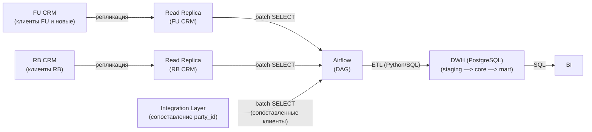
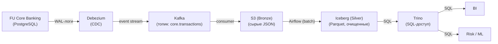
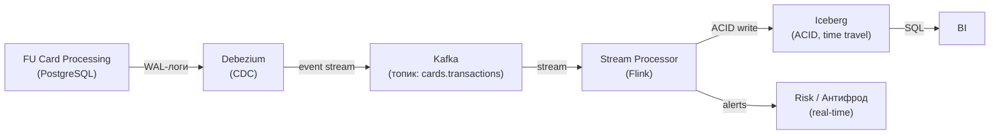
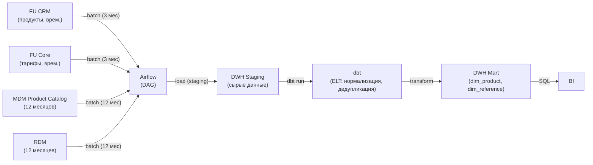

# data-pipelines.md — пайплайны данных: FinUnion + RetailBank

> Назначение документа: описать пайплайны данных для целевой архитектуры (12 месяцев) и промежуточного состояния (3 месяца). Чтобы проследить как данные попадают из источников в хранилища и с помощью каких инструментов.

## Таблица пайплайнов

| ## | Пайплайн | Источник | Приёмник | Тип | Инструменты | Состояние |
| -- | -- | -- | -- | -- | -- | -- |
| 1 | **Клиентские данные (DWH)** | FU CRM, RB CRM, Integration Layer | DWH (PostgreSQL) | Batch (ETL) | Airflow, Python/SQL | **3 месяца** |
| 2 | **История транзакций (Lakehouse)** | FU Core (WAL) | Lakehouse (Iceberg) | CDC + Streaming | Debezium, Kafka, Airflow, Spark/SQL | **12 месяцев** |
| 3 | **События карточных операций** | FU Cards (WAL) | Lakehouse (Iceberg) | CDC + Streaming | Debezium, Kafka, Flink | **12 месяцев** |
| 4 | **Справочники и продукты** | MDM Product Catalog, RDM | DWH (PostgreSQL) | Batch (ELT) | Airflow, dbt | **3-12 месяцев** |

## Пайплайн 1: Клиентские данные (DWH, 3 месяца)

### 1.1. Общая информация

| Параметр | Описание |
| -- | -- |
| **Источник** | FU CRM (клиенты FU и новые), RB CRM (клиенты RB), Integration Layer (сопоставление) |
| **Целевое хранилище** | DWH (PostgreSQL) |
| **Потребители** | BI, Регулятор |
| **Тип** | Batch (ETL) |
| **Инструменты** | Airflow (оркестрация), Python/SQL (трансформация) |

### 1.2. Схема пайплайна

### 1.3. Шаги пайплайна

| ## | Шаг | Что делает | Инструмент |
| -- | -- | -- | -- |
| 1 | Extract | Airflow читает клиентов из Read Replica FU CRM и Read Replica RB CRM, а также сопоставленных клиентов из Integration Layer | Airflow (PostgresHook) |
| 2 | Transform | Очистка, дедупликация (по party_id), обогащение (сегмент, регион, отделение) | Python/SQL |
| 3 | Load | Загрузка в staging —> core (DWH) | SQL (INSERT/UPSERT) |
| 4 | Aggregate | Построение витрины (mart) для BI | SQL (GROUP BY) |

**Примечание**:

- MDM Customer Hub на промежуточном этапе (3 месяца) ещё не существует. На этом этапе одновременное сосуществование двух временных мастер-систем и объединение данных.

## Пайплайн 2: История транзакций (Lakehouse, 12 месяцев)

### 2.1. Общая информация

| Параметр | Значение |
| -- | -- |
| **Источник** | FU Core Banking (WAL-логи PostgreSQL/Oracle) |
| **Целевое хранилище** | Lakehouse (S3 + Iceberg) |
| **Потребители** | BI (Trino), RiskManagement (ML), Регулятор (аудит) |
| **Тип** | CDC + Streaming |
| **Инструменты** | Debezium (CDC), Kafka, Airflow (оркестрация), Spark/SQL |

### 2.2. Схема пайплайна

### 2.3. Шаги пайплайна

| ## | Шаг | Что делает | Инструмент |
| -- | -- | -- | -- |
| 1 | Capture | Debezium читает WAL-логи FU Core (INSERT, UPDATE, DELETE) | Debezium |
| 2 | Stream | Debezium публикует события в Kafka (топик `core.transactions`) | Kafka |
| 3 | Land (Bronze) | Kafka-консьюмер сохраняет сырые JSON в S3 (Bronze) | Python consumer |
| 4 | Transform (Silver) | Airflow запускает batch-трансформацию: очистка, дедупликация, типизация —> Iceberg (Silver) | Airflow + Spark/SQL |
| 5 | Publish (Gold) | Trino предоставляет SQL-доступ к Iceberg для BI и Risk | Trino |

**Примечание**:

- Medallion Architecture (Bronze —> Silver —> Gold) формируем прогрессию качества данных

## Пайплайн 3: События карточных операций (Lakehouse, 12 месяцев)

### 3.1. Общая информация

| Параметр | Значение |
| -- | -- |
| **Источник** | FU Card Processing (WAL-логи) |
| **Целевое хранилище** | Lakehouse (Iceberg) |
| **Потребители** | RiskManagement (ML, антифрод), BI |
| **Тип** | CDC + Streaming |
| **Инструменты** | Debezium (CDC), Kafka, Flink (stream processing) |

### 3.2. Схема пайплайна

### 3.3. Шаги пайплайна

| ## | Шаг | Что делает | Инструмент |
| -- | -- | -- | -- |
| 1 | Capture | Debezium читает WAL-логи FU Cards | Debezium |
| 2 | Stream | Debezium публикует события в Kafka (топик `cards.transactions`) | Kafka |
| 3 | Process | Stream Processor вычисляет real-time метрики (velocity, аномалии) | Flink |
| 4 | Sink | ACID-запись в Iceberg (для аудита и BI) | Iceberg |
| 5 | Alert | Real-time алерты для антифрода | Kafka sink |

**Примечание**:

- Kafka, CDC, stream processing и real-time alerts обеспечивают работу антифрода

## Пайплайн 4: Справочники и продукты (DWH, 3-12 месяцев)

### 4.1. Общая информация

| Параметр | Значение |
| -- | -- |
| **Источник** | MDM Product Catalog, RDM |
| **Целевое хранилище** | DWH (PostgreSQL) |
| **Потребители** | BI, все системы (через DWH) |
| **Тип** | Batch (ELT) |
| **Инструменты** | Airflow, dbt |

### 4.2. Схема пайплайна

### 4.3. Шаги пайплайна

| ## | Шаг | Что делает | Инструмент |
| -- | -- | -- | -- |
| 1 | Extract | Airflow читает продукты и справочники из FU CRM / FU Core (3 месяца) или MDM Product Catalog / RDM (12 месяцев) | Airflow |
| 2 | Load (Staging) | Загрузка в staging DWH | SQL |
| 3 | Transform (dbt) | dbt выполняет ELT: нормализация, дедупликация | dbt |
| 4 | Publish | Витрины dim_product, dim_reference | SQL |

**Примечание**:

- 3 месяца: источники — FU CRM (продукты, врем.) и FU Core (тарифы, врем.), потому что MDM Product Catalog / RDM ещё не существуют.  
  12 месяцев: источники — MDM Product Catalog и MDM Reference Data Management (целевые мастера).
- ELT (а не ETL) потому что DWH на PostgreSQL/Greenplum может выполнять трансформации внутри.
- dbt стандарт для ELT.

## Сводная таблица DWH-сценариев

| Сценарий | Источник | Характер данных | Объём данных | Целевое хранилище | Способ обработки | Потребители |
| -- | -- | -- | -- | -- | -- | -- |
| Клиентские данные | FU CRM + RB CRM + Integration Layer | Структурированные (клиенты, обращения) | Терабайты (сотни тысяч клиентов) | DWH (PostgreSQL) | Batch (ETL) | BI, Регулятор |
| Справочники и продукты | FU CRM / FU Core (3 мес), MDM / RDM (12 мес) | Структурированные (продукты, тарифы, справочники) | Гигабайты (тысячи записей) | DWH (PostgreSQL) | Batch (ELT) | BI, все системы |

## Сводная таблица сценариев больших данных

| Сценарий | Источник | Характер данных | Объём данных | Целевое хранилище | Способ обработки | Потребители |
| -- | -- | -- | -- | -- | -- | -- |
| История транзакций | FU Core (WAL) | Исторические, событийные (каждая транзакция) | Петабайты (история за годы) | Lakehouse (Iceberg) | CDC + Streaming + Batch (Silver) | BI, RiskManagement, Регулятор |
| События карточных операций | FU Cards (WAL) | Событийные (real-time) | Петабайты (миллионы операций в день) | Lakehouse (Iceberg) | CDC + Streaming | RiskManagement (антифрод), BI |

## Инструменты и их роли

| Инструмент | Роль |
| -- | -- |
| Airflow | Оркестрация batch-пайплайнов |
| Debezium | CDC (захват WAL-логов) |
| Kafka | Event streaming |
| dbt | ELT-трансформации |
| Iceberg | Табличный формат (ACID, time travel) |
| Trino | SQL-доступ к Lakehouse |
| Flink | Stream processing |
