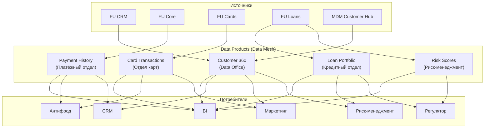

# data-products.md — доменные Data Products: FinUnion + RetailBank

> Назначение документа: показать, как элементы Data Mesh могут применяться в целевой архитектуре данных объединённого банка, на примере нескольких доменных data-продуктов.

## Data Products

| ## | Data Product | Домен | BIAN-домен | Назначение | Основные данные | Владелец | Потребители | Источники | SLA | Качество | Безопасность |
| -- | -- | -- | -- | -- | -- | -- | -- | -- | -- | -- | -- |
| 1 | **Customer 360** | Клиенты | Party Reference Data Directory | Единый профиль клиента (ФЛ, ЮЛ, ИП)  ***главная цель после слияния*** | `party_id` `inn` `pasport_masked` `ФИО/Наименование` `контакты` `согласия` `segment` | Data Office (MDM Customer Hub) | CRM, BI, маркетинг, риск-менеджмент | MDM Customer Hub, FU CRM, RB CRM (сопоставление) | Near real-time (обновление < 5 мин) | Полнота ФИО, ИНН; уникальность party_id; дедупликация | Шифрование, RBAC, маскирование ПДн, аудит |
| 2 | **Loan Portfolio** | Кредиты | Consumer Loan | Кредитный портфель (выдачи, остатки, платежи)  ***ключевой для отчётности и риск-менеджмента*** | `loan_id` `party_id` `amount` `loan_rate` `loan_term` `balance` `status` `payment_schedule` | Кредитный отдел (FU Loans) | BI, риск-менеджмент, регулятор | FU Loans, MDM Customer Hub (party_id) | Ежедневно (batch, к 06:00) | Полнота loan_id; корректность графика платежей; уникальность | Шифрование, RBAC, маскирование сумм |
| 3 | **Payment History** | Платежи | Payment Order | История платежей (переводы, погашения)  ***для антифрода (real-time) и клиентского сервиса*** | `payment_id` `from_account_id` `to_account_id` `amount` `currency` `status` `payment_date` | Платёжный отдел (FU Core) | BI, антифрод, клиентский сервис | FU Core, MDM Customer Hub | Near real-time (CDC, < 5 мин) | Полнота payment_id; корректность статусов; отсутствие дублей | Шифрование, RBAC, маскирование реквизитов |
| 4 | **Card Transactions** | Карты | Card Clearing | Карточные операции (покупки, снятия)  ***для антифрода (real-time) и маркетинга (анализ покупок)*** | `transaction_id` `card_id_masked` `party_id` `amount` `merchant` `status` `transaction_date` | Отдел карт (FU Cards) | BI, антифрод, маркетинг | FU Cards, MDM Customer Hub | Near real-time (CDC + streaming, < 1 мин) | Полнота transaction_id; корректность merchant; отсутствие дублей | Токенизация карты, RBAC, маскирование |
| 5 | **Risk Scores** | Риски | Credit Risk Models | Скоринг клиентов (кредитный риск)  ***для кредитования и регуляторной отчётности*** | `risk_id` `party_id` `score` `model` `calc_date` `status` | Риск-менеджмент (FU Loans) | Кредитный отдел, BI, регулятор | FU Loans, MDM Customer Hub | Ежедневно (batch) | Полнота score; корректность модели; уникальность | Шифрование, RBAC, маскирование баллов |

## Связь с Data Mesh

| Принцип Data Mesh | Описание | Как реализовано |
| -- | -- | -- |
| **Domain ownership** | Домены владеют данными | 5 доменов: клиенты, кредиты, платежи, карты, риски |
| **Data as a Product** | Данные это продукт с владельцем, контрактом, SLA | 5 data products с владельцем, SLA, качеством и мерами безопасности |
| **Self-serve platform** | Общая платформа (Airflow, DataHub) | Airflow (оркестрация), DataHub (каталог), Trino (SQL) |
| **Federated governance** | Единые правила (идентификаторы, качество) | Единые `party_id`, справочники (MDM системы), качество (DQ) |

## Диаграмма положения Data Products в архитектуре системы

