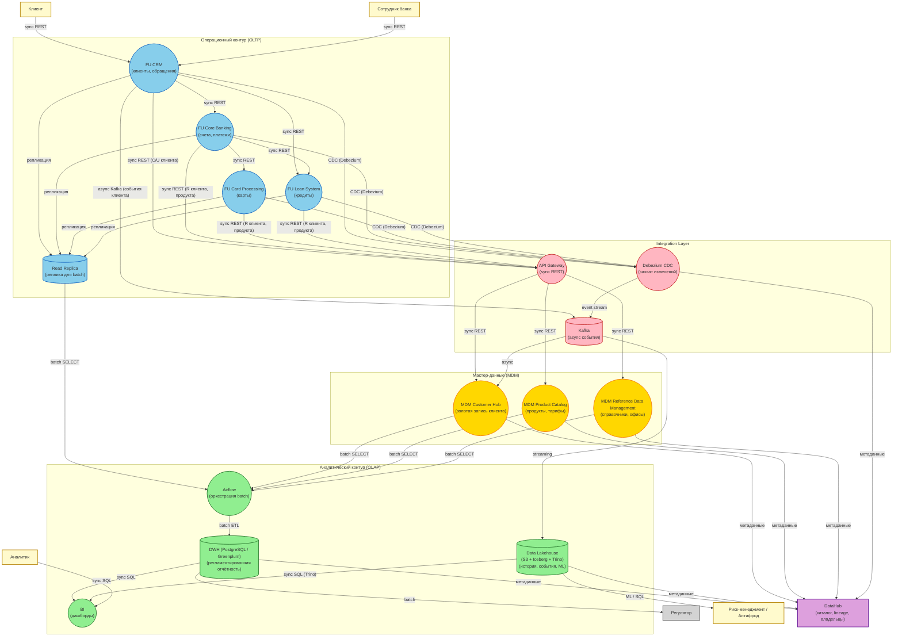

# target-data-architecture.md — целевая архитектура данных (To-Be): FinUnion + RetailBank

> Назначение документа: спроектировать целевую архитектуру данных для объединённой компании FinUnion через 12 месяцев после слияния с RetailBank.

## Ключевые изменения относительно промежуточного состояния (3 месяца)

| Изменение | 3 месяца (промежуточное решение) | 12 месяцев (целевое решение) |
| -- | -- | -- |
| Мастер-система клиентов | FU CRM (временно) + RB CRM (временно) | MDM Customer Hub |
| Мастер-система продуктов/справочников | FU CRM / FU Core (временно) + RB CRM / RB Core (временно) | MDM Product Catalog / Reference Data Management |
| Операционные контуры | FinUnion + RetailBank (параллельно) | FinUnion (RB выведен) |
| Аналитика | DWH | DWH + Data Lakehouse |
| CDC / Streaming | Нет | Debezium (CDC) + Kafka (Streaming) |
| Каталог данных | DataHub (базовый) | DataHub (полный lineage) |

## DFD level 0 (Целевая архитектура, 12 месяцев)

### Ключевые компоненты архитектуры

#### 1. MDM Customer Hub (золотая запись клиента)

- Единый party_id (дедупликация)
- Золотая запись (ФИО, ИНН, паспорт)

#### 2. MDM Product Catalog и MDM Reference Data Management

- Единый каталог продуктов (унификация FU/RB)
- Единые справочники (валюты, страны, офисы)

#### 3. API Gateway (sync REST)

- Единая точка (безопасность, RBAC, аудит) для запросов к MDM
- Создание/обновление клиента (FU CRM —> MDM)
- Чтение клиента/продукта (FU Core / Cards / Loans —> MDM)

#### 4. Kafka (async события)

- Стандарт для событийных потоков
- Асинхронный обмен между системами
- Буфер для пиковых нагрузок
- Основа для CDC и streaming
- События для мониторинга
- Real-time реакция на подозрительные операции
- Kafka стримит события (карточные операции) —> Lakehouse —> Risk (ML)

#### 5. Debezium (CDC)

- Стандарт для захвата изменений из Oracle/PostgreSQL
- Захват всех изменений (INSERT, UPDATE, DELETE) из WAL-логов не нагружая операционную БД
- Полная история транзакций (без потерь)
- At-least-once доставка (гарантия доставки)
- Real-time для Lakehouse (история, антифрод)

#### 6. Read Replica (реплика для batch)

- Read-only реплика (не участвует в выборах мастера)
- Airflow Batch из реплики (не нагружает операционную БД)
- Репликация с мастера (FU CRM / Core / Cards / Loans)
- Задержка репликации не критична для batch (раз в сутки)

#### 7. DWH (PostgreSQL / Greenplum)

- SQL-доступ
- Историчность
- Воспроизводимость
- Изоляция от OLTP
- Агрегации по клиентам, счетам, транзакциям и т.д.
- Готовые витрины для BI
- Регуляторная отчётность

#### 8. Data Lakehouse (S3 + Iceberg + Trino)

- Дешевое хранение (S3)
- Масштабируемость
- SQL-доступ (Trino)
- Schema-on-read (гибкость)
- Воспроизводимость благодаря снимкам (Iceberg)
- История транзакций (CDC)
- События карточных операций (streaming)
- Сырые данные для ML (антифрод)
- Архивы

#### 9. Airflow (оркестрация batch)

- DAG для ETL
- Идемпотентность
- Мониторинг
- Читает batch из Read Replica (FU CRM / Core / Cards / Loans)
- Читает batch из MDM (Customer Hub, Product Catalog, RDM)
- Загружает в DWH

#### 10. DataHub (каталог)

- Метаданные
- Трассируемолсть и Lineage (чтобы понимать откуда данные)
- Каталог data products

## Описание ключевых потоков

| ## | Источник | Приёмник | Режим обмена | Передаваемые сущности |
| -- | -- | -- | -- | -- |
| 1 | FU CRM | FU Core / FU Loans | Sync (REST) | Клиент, Договор, Заявка |
| 2 | FU CRM / Core / Cards / Loans | API Gateway | Sync (REST) | Клиент, Продукт, Справочник |
| 3 | API Gateway | MDM Customer Hub / Product Catalog / Reference Data Management | Sync (REST) | Клиент, Продукт, Справочник |
| 4 | FU CRM | Kafka | Async (события) | События Клиента (создание) |
| 5 | Kafka | MDM Customer Hub | Async | События Клиента |
| 6 | FU CRM / Core / Cards / Loans | Debezium | CDC | Изменения Образений, Транзакций, Карт, Кредитов |
| 7 | Debezium | Kafka | Async (event stream) | События изменений |
| 8 | Kafka | Lakehouse | Streaming | События (Карты, Кредиты, Транзакции, Обращения, Клиент) |
| 9 | FU CRM / Core / Cards / Loans | Read Replica | Репликация | Все операционные данные |
| 10 | Read Replica | Airflow | Batch (Parquet) | Операционные данные (SELECT) |
| 11 | MDM Customer Hub / Product Catalog / Reference Data Management | Airflow | Batch (Parquet) | Мастер-данные (SELECT) |
| 12 | Airflow | DWH | Batch (ETL) | Агрегации |
| 13 | DWH | BI | Sync (SQL) | Витрины |
| 14 | Lakehouse | BI | Sync (SQL через Trino) | История, события |
| 15 | DWH | Регулятор | Batch | Отчётность |
| 16 | Lakehouse | Risk | ML / SQL | Данные для антифрода |
| 17 | MDM / DWH / Lakehouse / Debezium | DataHub | Async | Метаданные, lineage |
