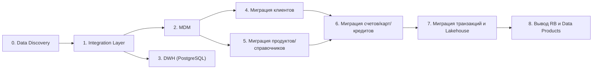
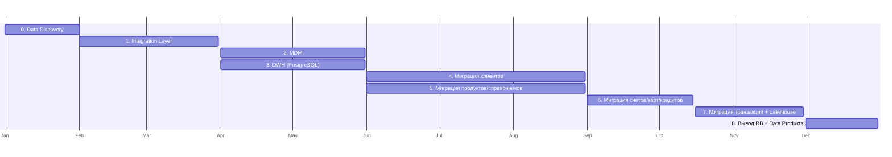

# migration-plan.md — инкрементальный план миграции: FinUnion + RetailBank

> Назначение документа: составить инкрементальный план миграции от As-Is к To-Be (12 месяцев). Нужно разбить переход на этапы, указать зависимости, определить результаты и критерии успеха.

## Инкрементальный план

### Таблица этапов

| Этап | Содержание | Результат | Длительность |
| -- | -- | -- | -- |
| **0. Data Discovery** | Инвентаризация систем, таблиц, потоков, владельцев | Реестр данных | 1 месяц |
| **1. Integration Layer** | API Gateway, Kafka, Debezium (базовый) | Сопоставление клиентов | 2 месяца |
| **2. MDM (Customer Hub, Product Catalog, RDM)** | Развёртывание MDM Customer Hub, Product Catalog, Reference Data Management | MDM готовы к приему данных | 2 месяца |
| **3. DWH (PostgreSQL)** | Развёртывание DWH на PostgreSQL | Регламентированная отчётность | 2 месяца |
| **4. Миграция клиентов** | Миграция клиентов RB в MDM | Все клиенты сопоставлены | 3 месяца |
| **5. Миграция продуктов/справочников** | Миграция продуктов RB в MDM Product Catalog, справочников RB в MDM RDM | Все продукты/справочники в MDM | 3 месяца |
| **6. Миграция счетов/карт/кредитов** | Миграция счетов RB в FU Core, карт RB в FU Cards, кредитов RB в FU Loans | Все счета/карты/кредиты в FU | 1,5 месяца |
| **7. Миграция транзакций и Lakehouse** | Миграция транзакций RB в FU Core + Lakehouse (CDC) | Все транзакции в Lakehouse | 1,5 месяца |
| **8. Вывод RB и Data Products** | Вывод RB-систем, Data Products (Data Mesh), DataHub (lineage) | Целевая архитектура | 1 месяц |

### Зависимости между этапами

**Примечание**: этапы 2 и 3 можно выполнять параллельно (MDM и DWH независимы). Этапы 4 и 5 можно параллельно (клиенты и продукты независимы).

### Временная шкала (12 месяцев)

## Детализация работ по этапам

### Этап 0: Data Discovery

| Параметр | Описание |
| -- | -- |
| **Цель** | Инвентаризация систем, таблиц, потоков, владельцев |
| **Работы** | Аудит систем (FU + RB), таблиц, потоков, владельцев; профилирование данных |
| **Результат** | Реестр данных (Data Catalog) |
| **Зависимости** | Нет |
| **Критерий завершения** | Реестр данных согласован с Data Office |
| **Как проверить** | Data Office подтвердил |

### Этап 1: Integration Layer (базовый)

| Параметр | Описание |
| -- | -- |
| **Цель** | Развернуть API Gateway, Kafka, Debezium (базовый) |
| **Работы** | Развернуть API Gateway (sync REST), Kafka (async), Debezium (CDC) |
| **Результат** | Сопоставление клиентов (identity resolution) |
| **Зависимости** | Этап 0 (Data Discovery) |
| **Критерий завершения** | Все клиенты RB сопоставлены (`party_id`) |
| **Как проверить** | SQL: `COUNT(*) WHERE party_id IS NULL = 0` |

### Этап 2: MDM (Customer Hub, Product Catalog, Reference Data Management)

| Параметр | Описание |
| -- | -- |
| **Цель** | Развернуть MDM Customer Hub (золотая запись клиента), Product Catalog, Reference Data Management |
| **Работы** | Развернуть MDM Customer Hub, Product Catalog, Reference Data Management; настроить дедупликацию, quality rules |
| **Результат** | Золотая запись клиента (`party_id`) |
| **Зависимости** | Этап 1 (Integration Layer) |
| **Критерий завершения** | 100% клиентов имеют `party_id` |
| **Как проверить** | SQL: `COUNT(*) WHERE party_id IS NULL = 0` |

### Этап 3: DWH (PostgreSQL)

| Параметр | Описание |
| -- | -- |
| **Цель** | Развернуть DWH на PostgreSQL |
| **Работы** | Развернуть DWH (PostgreSQL); настроить Airflow (batch); создать витрины |
| **Результат** | Регламентированная отчётность (BI) |
| **Зависимости** | Этап 1 (Integration Layer) |
| **Критерий завершения** | Все отчёты работают с DWH |
| **Как проверить** | BI-аудит |

### Этап 4: Миграция клиентов

| Параметр | Описание |
| -- | -- |
| **Цель** | Миграция клиентов RB в MDM Customer Hub |
| **Работы** | Batch-миграция клиентов; сопоставление (identity resolution); дедупликация |
| **Результат** | Все клиенты в MDM |
| **Зависимости** | Этап 2 (MDM) |
| **Критерий завершения** | 100% клиентов RB сопоставлены |
| **Как проверить** | SQL: `COUNT(*) WHERE source = 'RB' = 0` |

### Этап 5: Миграция продуктов/справочников

| Параметр | Описание |
| -- | -- |
| **Цель** | Миграция продуктов RB в MDM Product Catalog, справочников RB в MDM Reference Data Management |
| **Работы** | Batch-миграция продуктов и справочников; нормализация |
| **Результат** | Все продукты/справочники в MDM |
| **Зависимости** | Этап 2 (MDM) |
| **Критерий завершения** | 100% продуктов/справочников RB в MDM |
| **Как проверить** | SQL: `COUNT(*) WHERE source = 'RB' = 0` |

### Этап 6: Миграция счетов/карт/кредитов

| Параметр | Описание |
| -- | -- |
| **Цель** | Миграция счетов RB в FU Core, карт RB в FU Cards, кредитов RB в FU Loans |
| **Работы** | Batch-миграция счетов, карт, кредитов; сопоставление (`party_id`) |
| **Результат** | Все счета/карты/кредиты в FU |
| **Зависимости** | Этап 4 (клиенты), Этап 5 (продукты) |
| **Критерий завершения** | 100% счетов/карт/кредитов RB в FU |
| **Как проверить** | SQL: `COUNT(*) WHERE source = 'RB' = 0` |

### Этап 7: Миграция транзакций и Lakehouse

| Параметр | Описание |
| -- | -- |
| **Цель** | Миграция транзакций RB в FU Core + Lakehouse (CDC) |
| **Работы** | Развернуть Lakehouse (S3 + Iceberg + Trino); настроить CDC (Debezium) для истории транзакций |
| **Результат** | Все транзакции в Lakehouse |
| **Зависимости** | Этап 6 (счета/карты/кредиты) |
| **Критерий завершения** | 100% транзакций в Lakehouse |
| **Как проверить** | Trino: `COUNT(*) = полная история` |

### Этап 8: Вывод RB и Data Products

| Параметр | Описание |
| -- | -- |
| **Цель** | Вывод RB-систем, Data Products (Data Mesh), DataHub (lineage) |
| **Работы** | Вывод RB-систем; развернуть Data Products; DataHub (полный lineage) |
| **Результат** | Целевая архитектура |
| **Зависимости** | Этапы 1-7 |
| **Критерий завершения** | соответствие критериям из `migration-target-state.md` |
| **Как проверить** | Все проверки пройдены |
